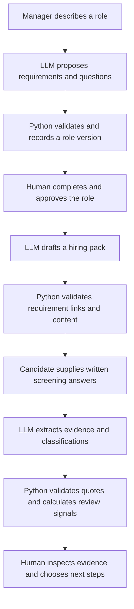

# LLM Hiring Agent

[](https://github.com/spar473/llm-hiring-agent/actions/workflows/tests.yml)

A Python application that helps a hiring manager turn a vague role request into an approved hiring brief, draft interview materials, and review candidate evidence against the same requirements.

**Explore it without an API key:** run the app and select **Load Offline Demo**. The demo contains a prepared fictional role, hiring pack, and candidate review. It makes no model requests.

## What problem does this solve?

A manager might start with: “We need a marketing intern who can help with content.” That leaves several questions unanswered. What should the person deliver? Which skills are essential on the first day? What can they learn? What evidence would show they can do the work?

This project makes those questions explicit before generating a job description or reviewing a candidate. A manager approves a structured role specification; the screening questions and candidate evidence are then linked back to its requirements. A reviewer can trace an assessment to the question, requirement, and quoted candidate response behind it.

It is a **hiring decision-support prototype**, with a Streamlit interface and a Python backend. Here, “agent” means an LLM-assisted, staged workflow with application-controlled tools and human approval. It has no autonomous recruiting loop, web research, candidate outreach, or authority to hire or reject someone.

## Walk through the project

| Step | What the user does | What the application produces |
| --- | --- | --- |
| 1. Define Role | Gives the role basics and describes the need | Proposed requirements, clarifying questions, assumptions, and contradictions |
| 2. Review Role | Completes role details, reviews requirements, resolves conflicts, and approves | A versioned role specification with explicit human confirmation |
| 3. Hiring Pack | Requests materials for the approved role | A draft job description, 5–7 screening questions, question-specific 0–5 rubrics, and follow-up guidance |
| 4. Candidate Evidence | Supplies written answers to the screening questions | Quoted evidence linked to requirements, missing information, confidence signals, and suggested follow-ups |
| 5. Batch Review | Opens a prepared CSV or uses the batch CLI | A sortable review queue that helps a person organise evidence review |

For example, “script and film three approved posts per week” can become a must-have requirement. A screening question asks for a comparable project. The candidate's own description of their actions becomes evidence for that requirement. The reviewer can inspect the quote and ask for missing details instead of relying on an unexplained overall score.

## Try it locally

Use **Python 3.12**. From a terminal:

```bash
git clone https://github.com/spar473/llm-hiring-agent.git
cd llm-hiring-agent
python3.12 -m venv .venv
source .venv/bin/activate
python -m pip install -r requirements.txt
python -m streamlit run app.py
```

On Windows/PowerShell, create the environment with `py -3.12 -m venv .venv`, activate it with `.\.venv\Scripts\Activate.ps1`, then run the last two commands above.

Open the local address printed by Streamlit, usually `http://localhost:8501`.

1. In **Define Role**, select **Load Offline Demo**.
2. Open **Review Role** to inspect the approved fictional Marketing Intern role and the information required for approval.
3. Open **Hiring Pack** to read its prepared job description, screening questions, and rubrics.
4. Open **Candidate Evidence** to inspect the stored candidate review, source quotes, missing evidence, and follow-ups.
5. In **Batch Review**, inspect the automatically loaded sample review queue.
6. Return to **Define Role** and select **Load Conflicting-Stakeholders Demo** to see why a conflicting role needs review before approval.

The offline demo displays prepared data; it does **not** generate answers to new prompts. Editing a role can make its existing hiring pack stale. Generating replacement materials and evaluating new candidate answers require a configured provider. See the [complete walkthrough](docs/GETTING_STARTED.md).

## Optional live LLM workflow

Live discovery, generation, and candidate evaluation use **OpenRouter**, through its OpenAI-compatible HTTP API. This does not require an OpenAI Platform key.

```bash
cp .env.example .env
```

Set `OPENROUTER_API_KEY` and `OPENROUTER_MODEL` in that ignored local file. Choose a model available to your account that supports the structured-output requests used by this application. Restart the app and inspect **System Status**. Provider requests can spend credits.

| Setting | Meaning |
| --- | --- |
| `OPENROUTER_API_KEY` | Your OpenRouter credential; never commit it |
| `OPENROUTER_MODEL` | Provider/model identifier from your OpenRouter account |
| `OPENROUTER_BASE_URL` | Defaults to `https://openrouter.ai/api/v1` |
| `APP_ENV` | Environment label; defaults to `development` |

**Verification status:** this public edition is verified using offline tests and the prepared demo. Live OpenRouter calls have not been reverified for this edition because a working key was unavailable. Sanitized historical examples are retained as regression fixtures; they are not evidence of current model availability or hiring accuracy.

## What the engineering demonstrates

- **Structured LLM integration:** typed Pydantic models, explicit JSON schemas, source-quote checks, bounded retries, and rejected-output handling.
- **Stateful workflow design:** Python controls stage progression, completeness checks, approval, and whether artifacts still match their source role version.
- **Traceable outputs:** requirements have stable identifiers; questions and candidate evidence refer to those identifiers. Hiring packs record reference hashes and model/prompt provenance.
- **Human review:** editable role sections and artifacts, explicit role approval, and versioned changes with audit events.
- **Defensive input handling:** role notes, reference documents, and candidate text enter as untrusted data. Validators check grounding, IDs, content rules, and evidence consistency.
- **Testable boundaries:** provider transport is separate from domain logic, so the automated suite can run without credentials or network calls.

The distinction that matters: **Python owns workflow and scoring arithmetic; the LLM supplies language interpretation and evidence labels.** Reproducible arithmetic does not make the underlying LLM judgement objective or correct.

## How the pieces fit together



| Location | Responsibility |
| --- | --- |
| `app.py` | Streamlit UI and orchestration |
| `src/models.py` | Typed data contracts |
| `src/discovery.py`, `src/workflow.py`, `src/readiness.py` | Requirement extraction, stage rules, role quality, and approval |
| `src/generation.py` | Reference loading, hiring-pack generation, validation, and edits |
| `src/evaluation.py`, `src/batch.py` | Evidence validation, review signals, and bounded batch processing |
| `src/llm_client.py`, `src/llm_diagnostics.py` | Provider requests and redacted diagnostics |
| `src/storage.py`, `src/observability.py` | Local JSON persistence, audit events, and session summaries |
| `prompts/` | Inspectable prompt templates |
| `references/` | Original fictional company values and example job descriptions |
| `data/fixtures/`, `tests/` | Prepared scenarios and automated regression checks |

Read the [technical architecture](docs/ARCHITECTURE.md) for approval gates, evidence scoring, storage boundaries, and design tradeoffs.

## Run the checks

```bash
python scripts/check_setup.py
python -m pytest -q
```

The suite contains **701 automated tests**. Neither command needs an API key. Tests replace the provider with controlled responses; passing tests verify application behavior under those responses, not live model quality.

To rebuild and validate the offline demo in a separate directory:

```bash
python scripts/prepare_fallback_session.py --offline --output-root data/outputs/demo-check
```

Running that script **without `--offline`** starts a live provider workflow. Other live scripts and the batch input format are described in [Getting started](docs/GETTING_STARTED.md).

Docker is also available:

```bash
docker build -t llm-hiring-agent .
docker run --rm -p 8501:8501 llm-hiring-agent
# For live mode, add: --env-file .env before the image name.
```

The container does not include `.env`. Sessions are local and disappear with a removed container unless a volume is mounted at `/app/data/sessions`.

## Scope and limitations

This is a portfolio prototype for reviewing **written screening responses**, not a complete applicant tracking system. It does not parse CVs, verify external claims, integrate with job boards, or send messages. It has no authentication, tenant isolation, production queue, or database. Local JSON audit events are application-managed records, not tamper-proof storage.

Readiness measures role completeness. Candidate confidence is an **uncalibrated evidence-quality heuristic**, not a probability of job success. Content rules and prompt-injection checks reduce some failure modes but do not prove fairness, security, or factual accuracy. Human review remains necessary.

See [limitations and next steps](docs/LIMITATIONS.md) and the [fixture guide](docs/SCENARIOS.md) for the precise boundaries and evidence available in this repository.
